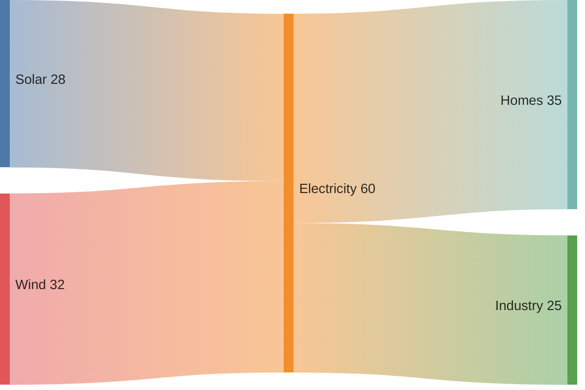
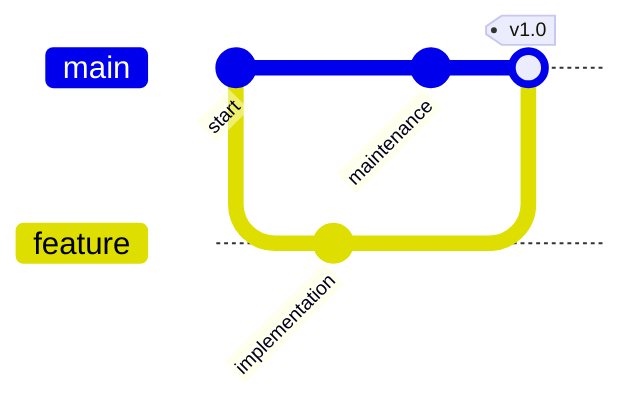
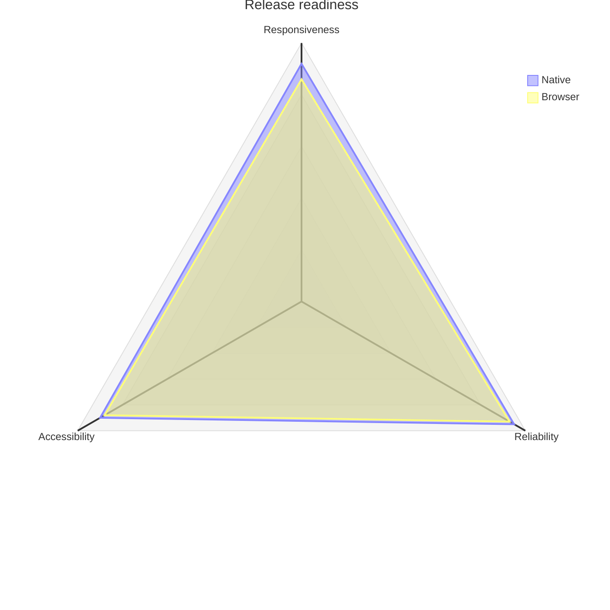
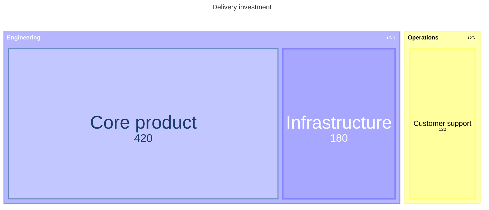

# Native Mermaid diagrams

The default renderer prepares Mermaid diagrams natively on macOS, iOS/iPadOS
and visionOS. Use `MarkdownRendererConfiguration` with its default
`DefaultMarkdownMermaidRenderer`, or supply a custom `MarkdownMermaidRenderer`.
Set `mermaidRenderer: nil` to leave diagram fences as source.

## Viewing and export

Prepared `MarkdownPreparedMermaidDiagram` values contain source, ASCII, light
and dark SVG, geometry, optional PDF variants and an accessibility summary.
The native viewer supports PDF selection, scrolling, zoom and file export.
`MarkdownMermaidDiagramAffordances` controls the viewport and zoom controls;
`MarkdownCodeBlockAffordances` controls copy, export and collapse actions.

Expanded diagrams use the whole canvas, with unfilled controls overlaid at its
edges. The active view and scale mode use text weight rather than a filled
segment or capsule. A soft canvas-edge fade keeps the controls readable when
content pans underneath them. Fit shows the entire figure, including a chart's
title, axes and legend, with clearance for the controls. Initial inline fitting
limits downscaling to keep labels readable. Wider figures pan within the reading
measure and offer Expand; explicit Fit can still shrink the whole figure to the
viewport. Inline figures retain their height limit. Actual Size and the zoom
percentage are relative to the figure at the host's configured text scale.

Zoom preserves the current viewing position. Switching between Diagram and
Source keeps the diagram viewport mounted, and switching appearance preserves
its zoom, pan and PDF text selection. Source opens at the top reading edge.

On UIKit, a long press selects a word and opens the native edit menu. Selection
handles adjust the range. The expanded and inline diagram viewers export files;
the collapsed code-style source action uses the host's code-export handler,
whose default UIKit behavior copies source.

When diagram content changes, selection is preserved when its label can be mapped
unambiguously to the new diagram. Appearance updates retain selection when its
extracted text positions are unchanged. On iOS 17 and later, an already active native
selection display is also preserved when the remapped native text range matches
the new PDF page. Clearing selection or replacing the logical document cancels
that intent.

Preparation occurs before view presentation. Resizing and zoom reuse prepared
resources. Streaming drafts also reuse vector artwork when the semantic parser's
accepted statements, consumed configuration and the renderer theme are unchanged. Authored source,
source ranges and frontier coverage still advance independently. ASCII export
retains its separate strict parsing behavior. The draft-artwork cache has both
entry and stored-byte limits.

Streaming native diagrams keep the current prepared vector page
visible through PDFKit page overlays and a current-page presentation during
overlay replacement. PDFKit retains selection and camera interaction.
Diagrams do not require a web view, remote fonts, image downloads or
document-provided scripts. SVG exports have remote font imports removed.
SVG canvas backgrounds use CSS; native image readers can display a transparent
canvas instead. PDF exports paint an explicit background.

## Syntax and limits

Supported families include flowchart, state, sequence, class, entity relationship,
XY chart, quadrant, pie, journey, timeline, mind map, Gantt, Sankey, GitGraph,
radar and treemap. Support covers a
subset of Mermaid syntax. Completed unsupported or malformed input retains the source
fence instead of displaying a partial diagram.

While an unsealed fence is streaming, the default renderer can display native
statements inside an open semantic container. `streamingProgress` records how
much authored source has been interpreted and whether a frontier or container
remains open. Source export preserves the complete authored input; PDF and SVG
exports describe the prepared draft. ASCII uses the strict source renderer and
can retain source while a container remains open. Finish uses strict parsing, so an
unfinished or unsupported completed fence returns to its source fallback.
An empty header or unfinished first statement retains source until the parser
owns drawable content.
Unfinished labeled subgraph headers stay pending. Open subgraphs and state
groups appear in the native artwork once they own a node. Sequence frames can
contain messages, notes, activity lifetimes or nested frames. An open frame waits
for an owned child; a completed empty frame with known participants retains its
measured header and body. Earlier completed nodes and actors
remain visible while each new container's header and first child arrive.
See [Streaming](streaming.md) for custom progressive renderer hooks.

Flowchart and state labels, and sequence participants, messages and notes, support
native LaTeX enclosed in Mermaid's `$$…$$` delimiters. Plain text and formulas can
share a label; `<br/>` separates label lines. For example:

```mermaid
flowchart LR
    A["Curvature $$R^{TM}$$"] -->|$$\frac{\eta(0)+h}{2}$$| B["Boundary correction"]
```

Formulas use the package's native math engine. Label sizing includes the formula's
measured width, ascent and descent. Preparation caches formula glyphs before the
viewer opens; resizing and zooming reuse the finished PDF. SVG exports embed the
prepared formula glyphs and their LaTeX descriptions without external resources.
PDF and SVG formula glyphs and rules use native vector outlines, so zoom and
export do not enlarge a formula bitmap. Ordinary PDF label text remains selectable.
Copy Source retains the original Mermaid and LaTeX.

Text-flow document PDF exports on macOS and iPadOS draw the same prepared vector
diagram page. Complete figures fit the printable measure, captions remain text,
and diagrams inside quotes and lists retain their indentation. An unsupported
or unavailable diagram retains its source and reports `.diagramsAsSourceText`.

Invalid or unclosed math in completed input retains the entire source fence. Math in other diagram
families also retains source. Preparation accepts at most 256 formula spans per
diagram and 32 KiB of source per span. Quoted flowchart labels preserve brackets,
parentheses and semicolons; completed unsupported flowchart statements and unclosed
subgraphs retain source instead of drawing an incomplete graph. State, sequence,
class and ER diagrams also retain source for completed unrecognized statements and unclosed
structures; a successfully prepared diagram does not silently omit those lines.

Class namespaces support nested blocks, dotted names, display labels and
reopening an existing namespace. Set `class.hierarchicalNamespaces` to `false`
in Mermaid configuration for compact projection. Class identity remains global;
namespace ownership follows the authored declarations. Native PDF/SVG,
accessibility descriptions and native text exports retain namespace labels and
membership. Static and abstract member classifiers retain their underline or
italic presentation.

Native PDF exports retain source mappings for shaped characters, emoji joiners,
modifiers, variation selectors and alternate Unicode spellings. Text-flow
document exports retain these mappings when embedding a prepared diagram.
Neutral text carries a leading Unicode direction mark so PDF readers preserve
its order beside right-to-left labels. That mark can appear in copied PDF text;
readers can also normalize Unicode and line breaks or infer a different reading
order for mixed-direction words. Use Copy Source for exact authored text. PDF
glyphs, color emoji and vector geometry are unchanged.

Flowchart links do not require spaces around their operators: `A-->B[Browser]`
keeps two nodes and one edge. Embedded labels such as `A--Review required-->B`
retain their text, and identifiers such as `release-2026` remain intact.
An unfinished edge opener remains a streaming frontier; it does not become a
node whose name includes the arrow or label.

Sequence `autonumber` accepts a start and increment, including hundredth precision;
`autonumber off` stops numbering. Standalone `activate Participant` and
`deactivate Participant` commands and message shortcuts such as `A->>+B` and
`B-->>-A` preserve chronological, nested activity lifetimes. Notes can precede
the first message and remain on their authored side of each activity boundary.
A later participant alias updates the existing participant without reordering
it. Deactivating an inactive participant retains the entire completed source
fence. An activity still open at the end extends to the figure's end; it does
not invent a closing command or count as an open structural frame.

Flat and grouped flowchart feedback edges retain
the authored arrow direction and source reading order. Flowchart subgraphs whose
child nodes connect outside inherit their parent's direction, following
[Mermaid's subgraph direction rule](https://mermaid.js.org/syntax/flowchart.html#direction-in-subgraphs).
Closed subgraphs retain their own explicit direction, including inheritance by
nested groups. Connecting to the subgraph itself preserves that local direction.
SVG paint accepts inert named or hex colors and numeric stroke widths,
not resource-bearing paint URLs.

Long geometry-family titles, journey tasks and Gantt labels wrap. XY chart titles
can be quoted or unquoted, such as `title "Monthly revenue"` or `title Revenue`.
XY charts adapt
category ticks to available space while retaining every data value and accessible
label. Automatic bar-chart scales include zero for positive, negative and mixed
values. An explicit `y-axis min --> max` overrides that scale; line-only charts
use a data-fitted automatic scale. Bar values are visible by default in the
native reader and PDF/SVG exports; ASCII output includes their numeric values.
To hide values for a particular chart, precede its header with
`%%{init: {"xyChart": {"showDataLabel": false}}}%%`. Set
`showDataLabelOutsideBar` to `false` to place values inside the bars. Quoted
categories retain spaces, commas and literal punctuation.

Horizontal charts reserve a separate category-label column and place signed
outside value labels at their bar ends. Resizing reuses prepared label measurements.
In the native reader, mixed vertical charts place outside bar values clear of
line marks and neighboring bars where space permits. Displaced values use
dotted leaders to identify their bars; resizing reuses prepared measurements
and series bounds.

Dense entity-relationship diagrams may place labels beside connectors or in a
gutter. Displaced captions use dotted leader lines to identify their relationships;
these leaders remain visually distinct from relationship connectors.

A complex graph can take substantial time to prepare. Cancellation occurs
between phases; it cannot interrupt the synchronous graph-layout call. Native
preparation is serialized, so one expensive graph can delay later work. Cache
entry limits do not impose a total byte budget on arbitrary diagram content.

## Geometry families

The native renderer accepts the following syntax for `quadrantChart`, `pie`,
`journey`, `timeline`, `mindmap`, `gantt`, `sankey`, `gitGraph`, `radar-beta`
and `treemap`. Unsupported input returns `nil`
from the renderer and leaves the source visible. Headers must stand alone or
be followed by whitespace. GitGraph and radar also accept the documented colon
after their headers.

| Family | Accepted | Refused |
| --- | --- | --- |
| `quadrantChart` | `title`; `x-axis low --> high` or `x-axis low`; `y-axis` likewise; `quadrant-1`…`quadrant-4`; `Name: [x, y]` with both in `0...1`. Direct point styles and forward `classDef`/`:::class` assignments for radius, fill and stroke; family layout configuration and theme colors, as described below. | A coordinate outside `0...1`; an empty body; malformed or unsupported point styles; any other line or unimplemented configuration. |
| `pie` | `pie`, `pie showData`, `pie title X`; `title X`; single/double quoted labels with escapes and embedded newlines, and unquoted `Label : number` rows. Outside-string `%%` comments; `accTitle:` and single-line or braced multiline `accDescr`. Duplicate and zero rows retain their labels and values; zero rows have no sector area. `showData` appends `[value]` to legend labels. Small and precise quantities retain their value, and finite totals may exceed the floating-point sum range. | Malformed quoted rows; negative or non-numeric values; no positive value; an unrepresentable positive share or sector; text containing characters invalid in XML; any other line. |
| `journey` | `title`; `section Name`; `Task: score`, `Task: score: Actor[, Actor]` with an integer score `1...5`. | A score outside `1...5` or non-integer; a task with no score; any other line. |
| `timeline` | `title`; `section Name`; `Period : Event[ : Event]`; a following `: Event` line joins the period above; a period without `:` has no events. | A body with no period; a continuation with no period above; an empty event. |
| `mindmap` | An indented tree; `text`, `[rectangle]`, `(rounded)`, `((circle))`, optionally with an id prefix (`root((Sirius))`). Children alternate right/left by source order; indentation defines the tree. | `::icon(...)`, `:::class`, backtick Markdown strings, an outdent to or past the root (a second root), an empty tree, mismatched brackets. |
| `gantt` | `title`, `section`, UTC date/time formats, decimal durations in `ms`/`s`/`m`/`h`/`d`/`w`/`M`/`y`, forward `after` and `until` dependencies, implicit subsequent starts, task tags, calendar exclusions/includes, configured axes, markers and compact rows. See below. | Invalid or cyclic references; impossible dates; ends before starts; a first task without a start; unknown directives/styles/configuration; resource or page bounds exceeded. |
| `sankey`, `sankey-beta` | Three CSV fields per flow: source, target, positive finite weight. Quoted labels support commas, doubled quotes and embedded newlines. Repeated flows stay distinct. | Cycles, self-loops, malformed rows, nonpositive weights, overflowing totals and configuration directives. |
| `gitGraph` | Default/LR, TB or BT orientation; `commit`, `branch` with optional `order`, `checkout`/`switch`, `merge` and `cherry-pick`. Quoted IDs, tags, messages and branch names; NORMAL, REVERSE and HIGHLIGHT commit types. YAML frontmatter title and the `gitGraph` controls described below. | Unknown references, duplicate IDs/branches, self-merges, invalid cherry-pick parents, unimplemented configuration settings and unsupported commands. |
| `radar-beta` | Ordered axis IDs with optional labels; named curves with positional or axis-keyed values; `min`, `max`, integral `ticks`, `graticule circle`/`polygon` and `showLegend true`/`false`. Entries can span lines. | Fewer than three axes; duplicate or unknown IDs; missing/extra values; negative/nonfinite data; invalid options or values outside the scale. |
| `treemap`, `treemap-beta` | Single/double quoted section and leaf labels; indented hierarchy or multiple roots; colon/comma followed by a positive decimal weight, including grouped thousands commas. Inert `classDef` and `:::class` styles as described below. | Empty completed sections, children of leaves, a dedent without an authored ancestor, malformed weights, unknown classes and unsupported styles/configuration. |

Pie percentages use compact whole-number labels. A positive share below 1% is
reported as `<1%`, and a partial share that would round to 100% is reported as
`>99%`. Unconfigured full-circle labels sit at the centre. Exact quantity text
remains in the legend when `showData` is enabled and in accessibility descriptions. ASCII bar
lengths round to terminal cells; zero rows never gain an invented filled cell.

Pie quoted labels decode escapes once, including escaped quotes, backslashes,
`\n`, `\r` and `\t`. Display entities such as `&quot;` decode after string parsing.
Literal `%%` inside a quoted label or braced description stays authored text.
Accessibility metadata supplies the spoken title and description without
replacing the visual title or hiding slice values. Repeated metadata uses the
last authored value. During streaming, an open braced description can accompany
already parsed slices; completed input requires the closing brace.

Pie YAML `config.pie` accepts `donutHole` from 0 to 0.9 and `textPosition`
from 0 to 1, measured from the centre to the outer radius. Donuts use true inner
contours in SVG and PDF, preserving transparent holes. Without an authored text
position, donut labels sit in the ring. `legendPosition` accepts `right` (the
native preset), `left`, `top`, `bottom` and `center`. Preparation wraps long key
labels and balances dense keys into measured columns, retaining complete logical
labels, authored order and font size. Centred donut keys reserve a measured hole;
the circle may grow while preserving its authored hole ratio and data shares.
A centred plain-pie key overlays the plotted data as requested, with a text halo
and percentages moved into keys when needed to avoid collisions.

`config.themeVariables` accepts `pie1` through `pie12`, `pieTitleTextColor`,
`pieSectionTextColor`, `pieLegendTextColor`, `pieStrokeColor` and
`pieOuterStrokeColor` as hexadecimal paints. Text sizes (`pieTitleTextSize`,
`pieSectionTextSize`, `pieLegendTextSize`) and stroke widths (`pieStrokeWidth`,
`pieOuterStrokeWidth`) accept nonnegative numbers or pixel strings. `pieOpacity`
accepts a number or numeric string from 0 to 1. Zero stroke width removes the
stroke. Layout reserves the full stroke extent. Percentage labels that cannot
fit their sector, ring or neighbouring labels move into the complete legend.
Unless `pieSectionTextColor` is authored, percentages use contrasting black or
white ink against each sector's paint and opacity over the theme canvas.
Other configuration retains the exact source.

Diagrams wider or taller than 11,000 layout points retain their source
instead of producing an oversized PDF. A bare `title` directive sets no title.
A Gantt line with a task separator is treated as a task even if its name begins
with a directive word, such as `Weekday standup :a, …`.

Quadrant point styles accept `radius`, `color`, `stroke-color` and
`stroke-width`. Radii are nonnegative integers; stroke widths are nonnegative
integers followed by `px`. Colors use three or six hexadecimal digits, with an
optional `#`. Direct properties override the corresponding class properties;
class definitions may follow their points. A stroke color alone does not add a
stroke. Double-quoted point names preserve punctuation such as a colon.

Point centers remain at their authored coordinates. Names stay inside the plot
when they fit clear of other names, marks, quadrant headings and the central
grid. Crowded charts use numeric callouts and a full name/value key below the
plot. Coincident or very close centers can share a callout; every point and its
coordinate values remain in the key. A large mark can move a quadrant heading
to a numbered caption outside the plot. ASCII exports retain the complete point
names, coordinate values and resolved paint settings. Plots that exceed the
measured callout capacity use a lettered-column and numbered-row reference grid
instead of leader lines across
the distribution. A key such as `D3/42` identifies its cell and point number;
every mark, full name and exact value remains. Long data keys use measured
columns, and their coordinate text wraps when needed. Keys and spoken
descriptions display coordinates without rounding them to a fixed number of
decimal places.

YAML frontmatter accepts quadrant settings under `config.quadrantChart`.
Unspecified settings retain the native preset. Numeric settings accept finite,
nonnegative values, including fractions, up to 11,000. A configured dimension
must leave room for a positive plot; an impossible size retains source.

| Controls | Settings |
| --- | --- |
| Chart and title | `chartWidth`, `chartHeight`, `titlePadding`, `titleFontSize`, `quadrantPadding` |
| Quadrant headings and borders | `quadrantTextTopPadding`, `quadrantLabelFontSize`, `quadrantInternalBorderStrokeWidth`, `quadrantExternalBorderStrokeWidth` |
| Axes | `xAxisLabelPadding`, `xAxisLabelFontSize`, `xAxisPosition` (`top`/`bottom`), `yAxisLabelPadding`, `yAxisLabelFontSize`, `yAxisPosition` (`left`/`right`) |
| Points | `pointTextPadding`, `pointLabelFontSize`, `pointRadius` |

Configured width and height size the base chart, including its title and axes.
Measured callouts and full data keys may extend the figure beyond that size.
Rectangular plots retain exact normalized point positions. Long headings and
axes wrap before rendering. In a chart without points, headings and paired axis
labels center within their respective halves; the x-axis can appear above the
plot. A chart with points places the x-axis below the plot. The y-axis can appear
on either side.

`config.themeVariables` accepts `quadrant1Fill` through `quadrant4Fill`,
`quadrant1TextFill` through `quadrant4TextFill`, `quadrantPointFill`,
`quadrantPointTextFill`, `quadrantXAxisTextFill`, `quadrantYAxisTextFill`,
`quadrantInternalBorderStrokeFill`, `quadrantExternalBorderStrokeFill` and
`quadrantTitleFill`. These colors use the same hexadecimal syntax as point
styles. Authored quadrant fills paint at full opacity. Direct and class point
colors override the configured point fill. Other theme variables and
unimplemented global or inherited diagram settings retain source.

Zero font sizes omit the corresponding painted and searchable labels while
retaining their source and semantic descriptions. A zero border width paints
no border, and a zero point radius paints no mark. Positive fractional font
sizes and radii remain positive in vector exports.

Gantt dates use UTC Gregorian arithmetic with English month/day names. Supported
`dateFormat` tokens include `YYYY`/`YY`, `Q`, `M`/`MM`/`MMM`/`MMMM`,
`D`/`DD`/`Do`/`DDD`/`DDDD`, `H`/`HH`/`h`/`hh`, `a`/`A`, `m`/`mm`,
`s`/`ss`, `S`/`SS`/`SSS`, `Z`/`ZZ` and Unix seconds/milliseconds `X`/`x`.
Bracketed text is literal. Impossible dates and conflicting date components
retain source. Offsets are converted to UTC; the authored source is unchanged.
Time-only or partial dates use the renderer's captured reference day/year.
`DefaultMarkdownMermaidRenderer(referenceDate:)` lets a host supply that instant;
the default initializer captures it once per renderer. The same instant controls
Today markers, draft preparation, exports and cache identity.

Tasks accept `done`, `active`, `crit`, `milestone` and `vert` tags. A subsequent
task may omit its start to use the preceding task's end. `after a b` uses the
latest referenced end; `until a b` uses the earliest referenced start. References
may point forward. Milestones appear halfway through their actual duration,
which still participates in scheduling. Vertical tasks produce named marker
lines without consuming task rows. Dependency arrows are not drawn.

Durations accept nonnegative decimals. Calendar months and years truncate the
fraction and clamp month ends; days round to the nearest day, and weeks round
seven times their value. Subday durations retain millisecond precision. With
`excludes weekends`, each excluded day strictly after the start and through the
moving end extends duration-based tasks. For example, Saturday `2026-09-26`
plus `2d` ends on `2026-09-29`. A weekend start remains as authored.
`weekend friday` selects Friday/Saturday; the default is Saturday/Sunday. `excludes` also
accepts weekday names and dates; `includes` dates override exclusions. Explicit
end dates bypass exclusion extension. `inclusiveEndDates` includes the explicit
end day. An excluded trailing span can remain visually empty while its full end
continues to govern dependencies.

`axisFormat` accepts UTC D3-style date/time directives and `-`, `_` or `0`
padding. `tickInterval` accepts a positive integer followed by `millisecond`,
`second`, `minute`, `hour`, `day`, `week` or `month`; `weekday` sets weekly
boundaries. Automatic ticks adapt to the date span, including century schedules.
`topAxis` adds a top axis alongside the bottom axis. `todayMarker off` hides
Today; its consumed styles are hexadecimal `stroke`, nonnegative `stroke-width`
with optional `px`, and `opacity` in `0...1`. `stroke:none` also hides it.

YAML frontmatter accepts `config.gantt` settings for `titleTopMargin`,
`barHeight`, `barGap`, `topPadding`, `leftPadding`, `rightPadding`,
`gridLineStartPadding`, `fontSize`, `sectionFontSize`, `numberSectionStyles`,
`axisFormat`, `tickInterval`, `topAxis`, `displayMode` and `weekday`. Numeric
sizes accept finite nonnegative fractions up to 11,000; section-style count is
an integer in `0...256`. `displayMode: compact` packs tasks only when their
bars and full labels fit without collisions. Explicit DSL directives take
precedence over the matching configuration. Zero sizes hide the corresponding
ink while retaining task semantics and source.

Gantt `config.themeVariables` consumes hexadecimal `sectionBkgColor`,
`altSectionBkgColor`, `sectionBkgColor2`, `excludeBkgColor`, `taskBorderColor`,
`taskBkgColor`, `activeTaskBorderColor`, `activeTaskBkgColor`, `gridColor`,
`doneTaskBkgColor`, `doneTaskBorderColor`, `critBorderColor`, `critBkgColor`,
`todayLineColor`, `vertLineColor`, `taskTextColor`, `taskTextOutsideColor` and
`taskTextDarkColor`. Authored colors remain the same in both appearances.
Other global/font/theme controls, string-valued font sizes, callbacks and click
commands retain source. Preparation accepts at most 256 KiB of source, 4,096
statements and 4,096 ticks; exclusion correction is bounded to 10,000 days.

Sankey ribbons and node bars share a quantitative scale. Node height represents
the larger of incoming and outgoing totals; the renderer does not invent flows
to balance a node. Labels retain complete names and numeric values. The limits
are 1,024 nodes, 4,096 flows and 256 KiB of source.



GitGraph maintains branch heads and commit ancestry in authored command order.
Cherry-pick requires an existing current head and a commit originating on another
branch; picking a merge commit requires an immediate parent. Solid connectors
show ancestry and dashed connectors show cherry-pick references. Commands end
at newlines or unquoted semicolons. Streaming publishes delimited commands;
strict completion also accepts a valid final command without a delimiter.
The limits include 512 commits, 64 branches, 4,096 statements and 256 KiB of source.

YAML frontmatter accepts a `title` and `config.gitGraph` settings for
`mainBranchName`, integral `mainBranchOrder`, `showBranches`, `showCommitLabel`,
`parallelCommits` and `rotateCommitLabel`. Rotation is opt-in and reserves
measured space for the commit label while keeping tags upright.
Checkout and merge commands resolve the configured main branch name. Hiding
branch names or commit labels releases their layout space while preserving the
history, tags and spoken description. With `parallelCommits: true`, commits
that have the same ancestry depth share a measured column or row; merges follow
both parents. A cherry-pick reference does not create an ancestry dependency.
Delayed first commits on a branch still visibly fork from their actual parent.
Wrapped vector labels retain one selectable SVG text element and their exact
authored spaces and line breaks.
Quoted strings, folded titles and bounded YAML aliases are supported. Duplicate
keys, invalid types, recursive aliases, custom object tags and unimplemented
settings retain the complete source. Frontmatter is limited to 32 KiB, 64 nested
collections, 4,096 expanded nodes and 256 KiB of expanded scalar/key text. An unfinished envelope remains literal
source while streaming; accepted frontier offsets include the envelope bytes.



Radar curves retain every value without smoothing or clamping. An external scale
ruler keeps numeric labels clear of the plot. Series use marker shapes and line
patterns alongside color. Automatic scales start at zero and end at the data
maximum; all-zero data uses `0...1`. Supported bounds are 3–32 axes, 1–16 curves,
1–32 ticks, 32,768 tokens and 256 KiB of source. A curve must provide exactly one
value for every axis, whether positional or keyed.



Treemap sibling tile areas are proportional to their weights. Nested sections
reserve local header and padding space before partitioning their child region.
Small tiles keep their true areas; labels that cannot fit as complete words
appear with their values and full hierarchy paths in a measured key. A numbered
marker identifies the tile when it has room. Wide, shallow leaves can place a
name and value on one line. Source, accessibility and ASCII preserve the hierarchy
and all values.

Treemap styles consume `fill`, `color`, `stroke` and `stroke-width`. Colors accept
three/six-digit hex, the basic CSS named colors and orange; stroke width accepts
`0...8` with optional `px`. URLs, arbitrary CSS, repeated properties and unknown
classes retain the entire source fence. For example:



Each indentation character, including a tab, counts as one indentation unit.
A common initial body indent is a margin; no parent is fabricated. Streaming
shows complete leaves under their authored parents while a trailing section
chain remains open. Finish refuses an empty section. Bounds are 2,048 nodes,
32 hierarchy levels and 256 KiB of source. Quantitative geometry that underflows
or cannot represent distinct positive extents retains source in Sankey, radar
and treemap.

## Platforms and dependencies

The native path is available on every included platform: macOS, iOS and
visionOS. Code highlighting is separate and uses its own bundled runtime.

The native module includes modified BeautifulMermaidSwift 1.0.4 (MIT) and uses
ElkSwift 1.0.2 (EPL-2.0). See [NOTICE](../NOTICE.md), the
[dependency license](ThirdParty/ElkSwift-EPL-2.0.txt) and
[upstream project](https://github.com/lukilabs/beautiful-mermaid-swift/tree/1.0.4)
for distribution notices and corresponding-source information.
